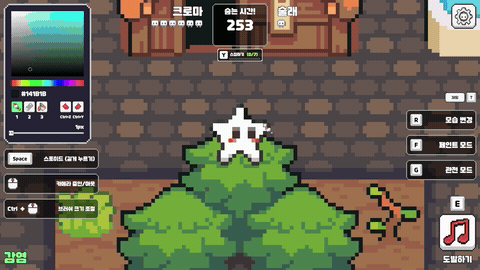
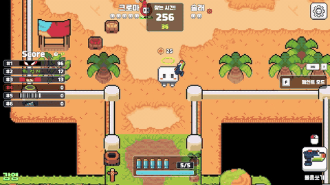
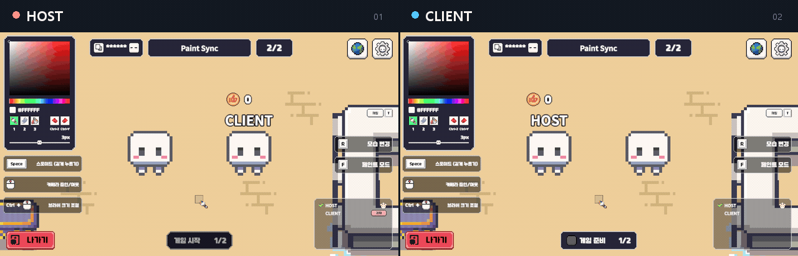
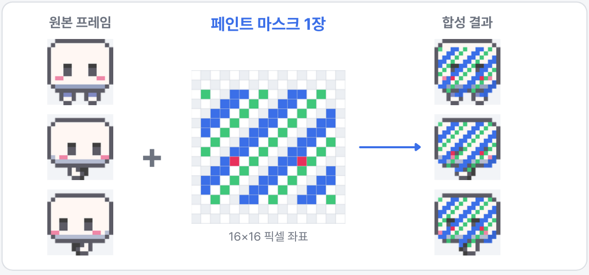
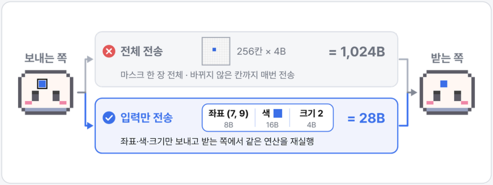
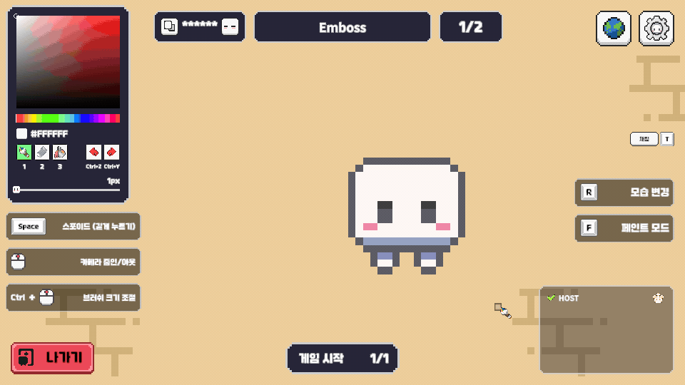
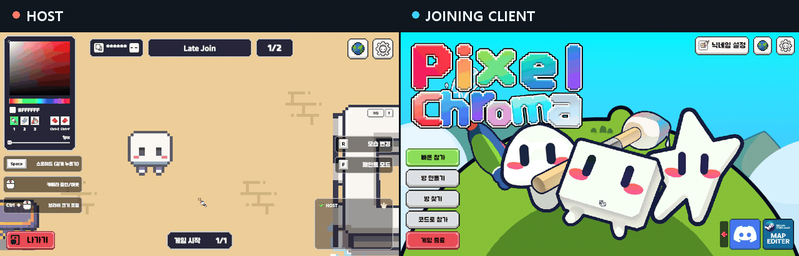
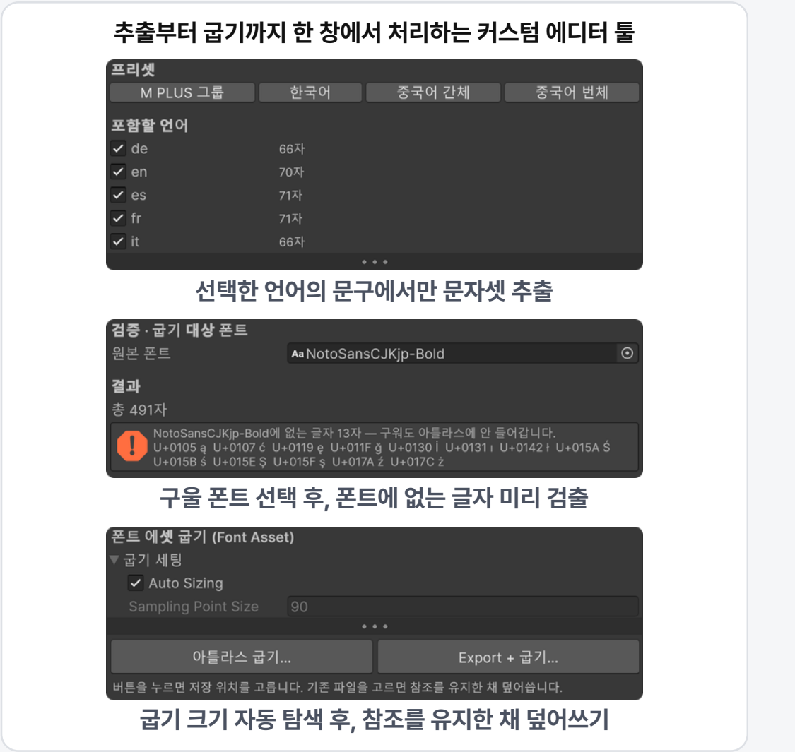

# PixelChroma

**몸을 배경색으로 칠해 숨고, 술래는 물총으로 찾아내는 2D 픽셀 멀티플레이 숨바꼭질 게임**

도망자는 픽셀 단위로 몸을 칠해 배경에 위장하고, 술래는 수상한 위치를 수색하며 물총으로 도망자를 찾아냅니다.

**Steam 스토어 공개 · 2026년 4분기 출시 예정**

개발자 4인 팀에서 페인트 동기화, 위장 엠보싱, 다국어 폰트 파이프라인, 매칭·로비와 네트워크 문제 해결을 담당했습니다.

-  [프로젝트 상세 포트폴리오](https://junghun-portfolio-rouge.vercel.app/projects/pixel-chroma)
-  [Steam 스토어](https://store.steampowered.com/app/5023800/)
-  [상세 포트폴리오 PDF](media/portfolio.pdf)
-  [플레이·구현 시연 영상](https://youtu.be/36jhe7z0E9g)

| 러너 · 색칠해서 숨기 | 시커 · 물총으로 수색하기 |
|:---:|:---:|
|  |  |

## 프로젝트 정보

| 항목 | 내용 |
|---|---|
| 개발 기간 | 2026.06 ~ 2026.09, 3개월 |
| 팀 구성 | 4인, 개발자 4명 |
| 담당 역할 | 페인트 동기화 · 위장 엠보싱 · 다국어 · 매칭/로비 · 네트워크 문제 해결 |
| 엔진 · 언어 | Unity 6 · URP 2D · C# |
| 플랫폼 | Windows PC / Steam |
| 주요 기술 | Mirror, FizzySteamworks, Steamworks.NET, UniTask, Addressables, Unity Localization |
| 지원 언어 | 한국어·영어·일본어 등 13개 언어 |

## 핵심 구현

### 1. 픽셀 페인트와 네트워크 동기화

캐릭터 형태별로 공통 페인트 마스크를 두고, 애니메이션의 현재 프레임에 합성해 프레임이 바뀌어도 칠한 위치를 유지합니다. 색칠 결과 전체를 매번 보내는 대신 좌표·색·브러시 크기를 전달해 원격 클라이언트에서 같은 연산을 수행하고, 실제 색이 바뀐 경우에만 전송합니다. 드래그 한 번을 Undo/Redo 기록 한 건으로 묶어 변경된 칸의 전·후 색을 보관하고, 되돌리기 결과도 변경 칸 단위로 동기화합니다.

왼쪽은 Host, 오른쪽은 Client입니다. 각 플레이어가 브러시로 칠하고, 지우개로 지운 뒤, 페인트통으로 전체를 채우는 결과가 양쪽 화면에 동일하게 반영됩니다.

공통 페인트 마스크 한 장을 모든 애니메이션 프레임이 공유하고, 현재 프레임에 합성해 칠한 위치를 유지합니다.

마스크 전체 대신 좌표·색·브러시 크기만 전송하고, 받는 쪽에서 같은 색칠 연산을 수행합니다.

대표 코드: [PlayerPaintCanvas](Scripts/Player/Common/PlayerPaintCanvas.cs) · [PlayerPaintCanvas.History](Scripts/Player/Common/PlayerPaintCanvas.History.cs)

### 2. 위장 밸런스를 위한 외곽선 엠보싱

배경과 같은 색으로 칠했을 때도 최소한의 형태 단서를 남기도록 외곽선에 하이라이트와 그림자를 적용했습니다. 주변 8칸의 투명 여부로 외곽선 법선을 구하고 광원 방향과의 내적으로 명암을 계산하며, 프레임별 법선은 초기화 시 미리 계산합니다. 방 설정에서 명암 강도를 조절하고, 실제 캐릭터와 설정 프리뷰가 같은 계산식을 사용하도록 분리했습니다.

배경색으로 몸을 칠한 상태에서 방 설정의 하이라이트·그림자 강도를 조절합니다. 프리뷰에서 확인한 설정을 적용하면 실제 캐릭터의 외곽선 명암도 함께 바뀝니다.

대표 코드: [PaintEmboss](Scripts/Player/Common/PaintEmboss.cs) · [UIEmbossPreview](Scripts/UI/Panels/Popup/UIRoomSetting/UIEmbossPreview.cs)

### 3. 매칭·로비와 네트워크 문제 해결

Steam 로비 생성·입장, 방 목록 검색과 빠른 매칭 흐름을 구현했습니다. 접속 시점과 씬 전환, 비동기 대기가 겹치는 상황에서 발생한 문제는 아래와 같이 처리했습니다.

| 문제 | 대응 | 대표 코드 |
|---|---|---|
| 늦게 입장한 클라이언트에 기존 색칠이 반영되지 않음 | 입장 시 호스트에 현재 상태를 요청하고, 칠해진 칸의 스냅샷을 요청자에게 전송 | [PlayerBase](Scripts/Player/Common/PlayerBase.cs) · [PlayerPaintCanvas](Scripts/Player/Common/PlayerPaintCanvas.cs) |
| 게임 종료 후 씬 전환에서 파괴된 플레이어의 이벤트 구독이 남아 연결이 끊김 | `OnDestroy`에서도 구독을 해제하고, 파괴된 객체에 대한 방어 처리 추가 | [PlayerBase](Scripts/Player/Common/PlayerBase.cs) · [RunnerPlayer](Scripts/Player/Runner/RunnerPlayer.cs) |
| 입장 중 방이 사라지면 타이틀 복귀 후 로딩이 다시 표시됨 | 연결이 끊기면 플레이어 생성 대기를 종료하고, 연결이 살아 있을 때만 타임아웃 복귀 처리 | [GameManager](Scripts/Core/GameManager.cs) |

Host가 먼저 무늬를 칠한 뒤 Client가 입장합니다. 입장 전에 칠해 둔 무늬가 새 Client 화면에 복원되고, 입장 이후의 색칠도 양쪽에 동일하게 반영됩니다.

대표 코드: [LobbyManager](Scripts/Core/Lobby/LobbyManager.cs) · [QuickMatchSearcher](Scripts/Core/Lobby/QuickMatch/QuickMatchSearcher.cs)

### 4. 13개 언어 폰트 파이프라인과 제작 도구

텍스트를 중앙 관리자에 등록하고, 언어별 폰트를 Addressables로 로드해 등록된 텍스트에 일괄 적용하는 구조를 구현했습니다. UI와 사용자 입력 텍스트의 폰트를 용도별로 관리하고, 새 폰트를 적용한 뒤 이전 폰트의 로드 핸들을 해제합니다. 에디터 도구에서는 Localization Tables의 문자셋 추출, 지원하지 않는 글자 검출, 아틀라스 크기에 맞는 굽기 크기 탐색을 연결하고 기존 폰트 에셋의 GUID를 유지해 참조를 보존합니다.

대표 코드: [LocalizationManager](Scripts/Core/LocalizationManager.cs) · [LocalizationCharSetWindow](Scripts/Editor/LocalizationCharSetWindow.cs)

## 공개 범위

이 저장소는 **개발 포트폴리오 검토를 위한 소스 열람용 저장소**입니다.

- `Scripts/`: 프로젝트의 C# 스크립트와 페인트 관련 셰이더. 핵심 구현에서 설명한 본인 담당 코드 외에 연관된 팀 프로젝트 코드도 포함합니다.
- `media/`: 상세 포트폴리오 PDF, 플레이·구현 시연 GIF, 대표 이미지·구성도·아이콘.
- Unity Scene·Prefab·프로젝트 설정·원본 아트·폰트 파일·외부 SDK와 라이브러리 원본은 포함하지 않아 **이 저장소만으로 실행하거나 빌드할 수 없습니다.**
- 외부 의존성에는 Mirror, Steamworks.NET, FizzySteamworks, UniTask, OneText 등이 있으며, 원본은 각 제공처의 이용 조건을 따릅니다.

코드와 자료에 별도의 오픈소스 이용 허락을 선언하지 않습니다. 재사용·재배포 시 권리자의 허락과 관련 라이선스를 확인해주세요. 팀 제작 아트와 외부 에셋·브랜드의 권리는 해당 권리자에게 있습니다.
